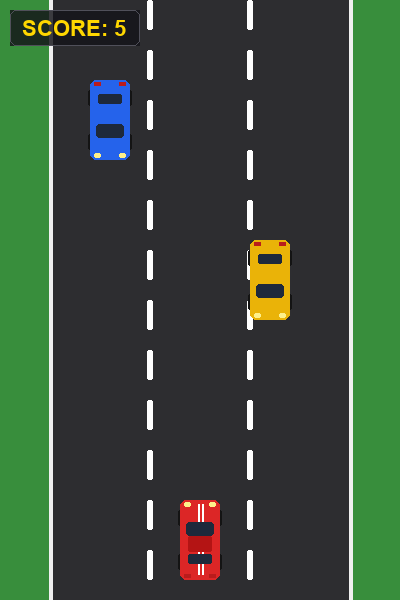
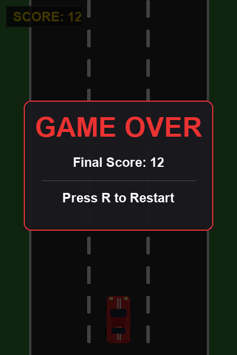

# 46_car racing game_RU_26-00599_1C

[](https://www.python.org/)
[](https://pyga.me/)
[](tests/test_game.py)
[](LICENSE)

An arcade-style 2D Car Racing Game built in Python 3 with Pygame. Developed as an academic software engineering project adhering strictly to the specifications of **Project Statement No. 46 (PS No. 46)**.

---

## 1. Project Introduction

The **Car Racing Game** is a fast-paced 2D vertical-scrolling racing game where the player maneuvers a sports car along a bounded asphalt highway, dodging oncoming traffic (obstacle cars) moving downward. The player earns points for every obstacle successfully navigated past the bottom of the screen. The objective is to achieve the highest possible score while avoiding collisions.

The project emphasizes clean architecture, separating core game logic from Pygame rendering. This separation enables 100% automated testability under headless conditions without requiring a graphical display server.

---

## 2. Problem Statement (PS No. 46)

Design and implement a robust 2D Car Racing Game in Python 3 using Pygame that fulfills the following strict parameters:
- Window dimensions of exactly **400x600 pixels** running at **60 FPS**.
- Road boundaries constrained between **X = 50** and **X = 350** (300px roadway).
- Player car sized **40x80 pixels**, starting at **(X=180, Y=500)**, moving horizontally **10 pixels per valid keystroke**, strictly clamped between **X = 50** and **X = 310**, with **no vertical movement**.
- Procedural obstacle cars (size **40x80 pixels**) spawning randomly across valid road coordinates, progressing downward, scoring exactly **+1 point per passed obstacle**, and disappearing once past screen height (**Y >= 600**).
- Collision detection using native Pygame `Rect.colliderect()`, triggering a Game Over screen showing the final score with an option to restart by pressing **R**.
- Verification against four specified test cases with zero regressions.

---

## 3. Project Objectives

1. **Deterministic Motion & Boundary Control**: Ensure precise horizontal step movement (10px) while maintaining strict road boundary constraints.
2. **Separation of Concerns (SoC)**: Isolate game state and arithmetic calculations (`Player`, `Obstacle`, `Game`) from rendering loops (`Surface.blit`, `pygame.draw`).
3. **Automated Verification**: Provide a test suite covering normal inputs, edge/boundary cases, invalid inputs, obstacle passing, collision detection, and game restarts.
4. **Visual Polish**: Procedurally render vehicles (windshields, tires, racing stripes, headlights/taillights) and scrolling lane markings without reliance on external asset files.

---

## 4. Technologies Used

- **Language**: Python 3 (compatible with Python 3.10, 3.11, 3.12, 3.13, 3.14)
- **Game Engine / Library**: `pygame` / `pygame-ce` (Community Edition for cross-platform SDL2 binaries)
- **Collision Detection**: `pygame.Rect.colliderect`
- **Testing Framework**: Python standard `unittest` framework (headless with `SDL_VIDEODRIVER=dummy`)
- **Version Control**: Git & GitHub

---

## 5. Game Features

- **Smooth 60 FPS Gameplay**: Regulated using `pygame.time.Clock()`.
- **Dynamic Procedural Graphics**: Cars rendered with body aerodynamics, tinted windshields, tires, and front/rear lights.
- **Highway Animation**: Scrolling road dashed lane dividers create an authentic sensation of high-speed transit.
- **Multi-Colored Traffic**: Enemy cars appear in distinct colors (Blue, Yellow, Orange, Purple, Teal, Rose).
- **Accurate Scoring Engine**: Obstacles are tracked with a `passed` flag to prevent duplicate scoring.
- **Game Over & Restart Flow**: Instant collision halt, final score preservation, and single-key (**R**) restart cycle.
- **Headless Test Mode**: Game logic can be instantiated and tested in CI/CD without opening an OS window.

---

## 6. Project Structure

```text
Car-Racing-Game/
│
├── main.py              # Main execution script and Pygame event loop
├── settings.py          # Centralized configuration constants and color definitions
├── player.py            # Player car class (input, boundary checks, rendering)
├── obstacle.py          # Obstacle car class (spawn, motion, pass detection)
├── game.py              # Game controller (orchestrates state, collisions, scoring)
│
├── tests/
│   ├── __init__.py      # Package marker
│   └── test_game.py     # Automated unit tests for all assignment test cases
│
├── screenshots/         # Captured gameplay and Game Over screen graphics
│   ├── gameplay.png
│   └── gameover.png
│
├── requirements.txt     # Python package dependencies
├── .gitignore           # Git ignore configuration
└── README.md            # Comprehensive project documentation
```

---

## 7. Installation Instructions

### Prerequisites
- Python 3.10 or newer installed on your machine.
- `pip` package manager.

### Step 1: Clone or Navigate to the Repository
```bash
git clone <repository-url>
cd Car-Racing-Game
```

### Step 2: (Optional but Recommended) Create a Virtual Environment
```bash
python3 -m venv .venv
source .venv/bin/activate    # On macOS/Linux
# or
.venv\Scripts\activate       # On Windows
```

### Step 3: Install Required Dependencies
```bash
pip install -r requirements.txt
```

---

## 8. How to Run the Game

Execute the game directly from your terminal:

```bash
python3 main.py
```

To exit the game at any time, press `ESC` or click the window close button (`X`).

---

## 9. Game Controls

| Key | Action | Details |
| :--- | :--- | :--- |
| `LEFT ARROW` | Steer Left | Moves car left by exactly 10 pixels (min X = 50) |
| `RIGHT ARROW` | Steer Right | Moves car right by exactly 10 pixels (max X = 310) |
| `R` | Restart Game | Resets player, obstacles, score, and restarts after Game Over |
| `ESC` | Quit Game | Closes the window and exits application cleanly |
| `SPACE / OTHERS` | Ignored | Invalid inputs are safely ignored without effect |

---

## 10. Test Cases and Expected Results

The test suite in [`tests/test_game.py`](tests/test_game.py) automates the exact scenarios specified in the assignment:

### Test Case 1: Normal Input
- **Initial State**: Player at `X = 180, Y = 500`, Score = `0`, Game running.
- **Action**: Key `RIGHT` pressed.
- **Expected Result**: Player moves to `X = 190`, Score = `0`, Game running.
- **Status**: `PASSED`

### Test Case 2: Boundary / Minimum Input
- **Scenario A (Left Boundary)**:
  - **Initial State**: Player at `X = 50`.
  - **Action**: Key `LEFT` pressed.
  - **Expected Result**: Player remains at `X = 50` (No movement).
  - **Status**: `PASSED`
- **Scenario B (Right Boundary)**:
  - **Initial State**: Player at `X = 310`.
  - **Action**: Key `RIGHT` pressed.
  - **Expected Result**: Player remains at `X = 310` (No movement).
  - **Status**: `PASSED`

### Test Case 3: Invalid Input
- **Initial State**: Player at `X = 180`, Game running.
- **Action**: Key `SPACE` (or any non-arrow key) pressed.
- **Expected Result**: Key ignored, Player remains at `X = 180`, Game running.
- **Status**: `PASSED`

### Test Case 4: Different Valid Scenario
- **Scenario A (Obstacle Passed)**:
  - **Initial State**: Starting score = `3`, Obstacle spawned at `(300, 600)`.
  - **Expected Result**: Obstacle detected as passed (`rect.y >= 600`), Score incremented to `4`, Obstacle removed.
  - **Status**: `PASSED`
- **Scenario B (Collision Detection & Game Over)**:
  - **Initial State**: Player at `(180, 500)`, Obstacle at `(200, 520)`.
  - **Expected Result**: Collision detected via `player_rect.colliderect(obstacle_rect)`, Game Over triggered (`game_over = True`), Final score preserved as `4`.
  - **Status**: `PASSED`

### Running the Test Suite
```bash
python3 tests/test_game.py
```
Or using standard unittest discovery:
```bash
python3 -m unittest discover tests
```

---

## 11. Screenshots

| In-Game Racing Action | Game Over & Final Score Screen |
| :---: | :---: |
|  |  |
| *Active gameplay with dashed road dividers, score badge, and oncoming traffic* | *Game Over modal overlay displaying final score and restart instruction* |

---

## 12. University Submission Checklist

- [x] Window dimensions: exactly 400x600 px
- [x] Frame rate: 60 FPS
- [x] Window title: "Car Racing Game"
- [x] Road boundaries: Left X=50, Right X=350
- [x] Player dimensions: 40x80 px, initial (180, 500)
- [x] Player movement: 10 px per keystroke, bounded within [50, 310]
- [x] No vertical player motion
- [x] Obstacle dimensions: 40x80 px, random road positions
- [x] Obstacles move downward and increment score by +1 upon passing Y=600
- [x] Collision detection via `player_rect.colliderect(obstacle_rect)`
- [x] Game Over screen displays "GAME OVER", final score, and "Press R to Restart"
- [x] Pressing 'R' resets player, obstacles, score, and restarts
- [x] All 4 assignment test cases automated and passing
